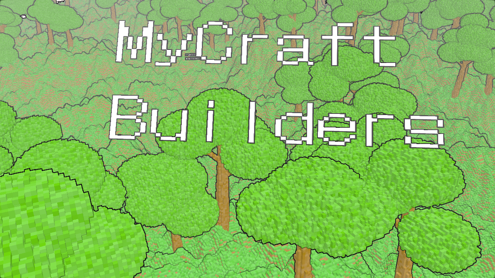

<a id="top"></a>

# NobleEngine

[](https://github.com/einzig1000/NobleEngine/actions/workflows/DebugBuild.yml)


-107C10)

<!-- 【要記入】ここから「なりたち・目的」。下は事実（git履歴・コード）から書いたたたき台なので、自分の言葉に直してください -->

**NobleEngine** は、DirectX 12 を使って一から作っている自作ゲームエンジンです。
2026年5月に学校の授業（CG2）で作り始めたエンジンを土台に、現在はこのエンジンでボクセル（ブロック）系サンドボックスゲーム **「MyCraft Builders」** を開発しています。

このエンジンで目指していること:

- **GPU駆動のボクセル描画** — チャンクの露出面をコンピュートシェーダーで抽出し、増幅シェーダー（AS）で見えない範囲を間引き、メッシュシェーダー（MS）で描画する
- **データ駆動の開発** — アイテム・UI・スキルツリーなどを JSON で持ち、ImGui 製のエディタからゲームを止めずに調整できる
- **ゲーム側からはファサード（`Game::`）だけで使える** — エンジン内部のマネージャ群を直接触らずに、読み込み・入力・カメラ・GPUリソースを扱える

<!-- 【要記入】作り始めた動機・名前の由来・就職作品としての位置づけなど -->



<a id="toc"></a>

## 目次

1. [主な特徴](#features)
2. [動作環境](#requirements)
3. [ビルドと実行](#build)
4. [ディレクトリ構成](#directory)
5. [エンジンの基本的な使い方](#usage)
6. [Game:: 関数リファレンス](#game-api)
   - [Game::Asset（読み込み）](#game-asset)
   - [Game::DebugDraw](#game-debugdraw)
   - [Game::IO（入力）](#game-io)
   - [Game::Camera](#game-camera)
   - [Game::Math](#game-math)
   - [Game::Time](#game-time)
   - [Game::Window](#game-window)
   - [Game::Resource（GPUリソース）](#game-resource)
   - [Game::System](#game-system)
   - [補助クラス（CounterSec / CounterF）](#game-counter)
7. [使用ライブラリとライセンス](#third-party)

---

<a id="features"></a>

## 1. 主な特徴

### 描画
- DirectX 12 / Shader Model 6.6（コンピュート・増幅・メッシュシェーダー）
- チャンク描画パイプライン: **CS で露出面を抽出 → AS で空グループ・視錐台外を間引き → MS で三角形を生成**
- 露出面は全チャンク共有のページプールに格納し、描画範囲外に出たチャンクのデータは解放する
- AS による間引きの導入で GPU FPS が約 130 → 190 に向上（2026-08-06 時点の実測）<!-- 【要確認】最新の構成で測り直すなら差し替え -->
- レンダーテクスチャ、フォント描画（stb_truetype）、スキンアニメーション

### エディタ（ImGui）
<!-- 【要確認】エディタ窓の正式な名前・できることを確認して追記 -->
- エンジン側: アセットプレビュー、GPUリソースプレビュー、時間エディタ
- ゲーム側: アイテムエディタ、UIエディタ、スキルツリーエディタ

### その他
- XAudio2 + Media Foundation による音声再生（mp3 など）
- キーボード・マウス・ゲームパッド（XInput、最大4台）入力
- GitHub Actions による Debug ビルドの自動確認

---

<a id="requirements"></a>

## 2. 動作環境

| 項目 | 内容 |
|---|---|
| OS | Windows 10 / 11（x64） |
| IDE | Visual Studio 2026（プラットフォームツールセット v145） |
| 言語 | C++23 |
| GPU | DirectX 12 Ultimate 対応（**メッシュシェーダー・Shader Model 6.6 が必須**） |

<!-- 【要確認】動作確認したGPU（自分のPCの型番）を書いておくと親切 -->

---

<a id="build"></a>

## 3. ビルドと実行

1. リポジトリをクローンする
2. `NobleEngine.slnx` を Visual Studio 2026 で開く
3. 構成を `Debug` または `Release`、プラットフォームを `x64` にしてビルド
4. 実行（作業ディレクトリは `NobleEngine/`。アセットは `assets/...` の相対パスで読み込みます）

- 出力先: `generated/outputs/<構成名>/`
- `dxcompiler.dll` / `dxil.dll` はビルド後イベントで出力先へコピーされます

<!-- 【要確認】Release の exe を単体で配る手順（UtilityPowerShell/CreateSubmission.ps1）を載せるか -->

### 操作方法

<!-- 【要記入】ゲームの操作（移動・採掘・インベントリなど）と、デバッグ用キー（F3 / F10 / F11 など）の一覧 -->

| キー | 動作 |
|---|---|
| | |

---

<a id="directory"></a>

## 4. ディレクトリ構成

```text
NobleEngine/                  … リポジトリのルート
├─ NobleEngine.slnx
├─ ThirdPartyNotices.txt      … 使用ライブラリのライセンス一覧
├─ UtilityPowerShell/         … 提出用パッケージ作成などのスクリプト
└─ NobleEngine/               … プロジェクト本体
   ├─ main.cpp                … エントリーポイント
   ├─ assets/
   │  ├─ engine/              … エンジンが使うアセット（既定モデル・テクスチャ・シェーダー等）
   │  └─ application/         … ゲームが使うアセット
   ├─ externals/              … 外部ライブラリ
   └─ src/
      ├─ engine/              … エンジン層
      │  ├─ Facade/           … Game:: ファサード（ゲーム側の窓口）
      │  ├─ AssetManager/     … モデル・テクスチャ・音声・フォント・アニメーション
      │  ├─ DirectX/          … デバイス・コマンド・パイプライン・リソース管理
      │  ├─ DrawSystem/       … RenderObject による描画
      │  ├─ ComputeSystem/    … ComputeObject による計算
      │  ├─ Camera/  IO/  TimeManager/  Window/  ImGuiManager/  Utilities/
      │  └─ Editor/           … エンジン側のエディタ窓
      └─ application/         … ゲーム層（MyCraft Builders）
         ├─ GameManager/      … フェーズ（タイトル・ゲーム本編など）の管理
         ├─ GameObjects/      … プレイヤー・マップ（チャンク）・UI・エフェクト
         ├─ Editor/           … アイテム・UI・スキルツリーのエディタ
         └─ System/           … イベントバス・リソース読み込み
```

---

<a id="usage"></a>

## 5. エンジンの基本的な使い方

### フレームの流れ

`main.cpp` がエンジンとゲーム（`Application`）を次の順で呼び出します。

```cpp
Engine::Instance().Initialize(width, height, L"タイトル");
Engine::Instance().BeginFrame();
Application::Instance().Initialize();   // 読み込みはフレームの内側で行う
Engine::Instance().EndFrame();

while (Engine::Instance().ProcessMessage())
{
    Engine::Instance().BeginFrame();
    Application::Instance().Update();
    Application::Instance().Draw();
    Application::Instance().DrawImGui();
    Engine::Instance().EndFrame();
}

Application::Instance().Finalize();
Engine::Instance().Finalize();
```

> **注意:** `Engine::Instance().GetXxxManager()` はエンジンの初期化中は `nullptr` のことがあります。ゲーム側からは `Game::` 経由で呼んでください。

### ID で扱う

モデル・テクスチャ・音声・カメラ・GPUリソースは、読み込み／作成時に返る **`int32_t` の ID** で扱います。

```cpp
int32_t model   = Game::Asset::Model::Load("assets/engine/model/cube/cube.obj");
int32_t texture = Game::Asset::Texture::Load("assets/engine/texture/uvChecker.png");
int32_t bgm     = Game::Asset::Audio::Load("assets/application/audio/BGM/Title.mp3");

int32_t playId  = Game::Asset::Audio::PlayAudio(bgm, true, 0.5f);  // 再生ごとに別のIDが返る
```

### 描画

描画は `RenderObject`（計算は `ComputeObject`）にシェーダーとデータを設定して `Draw()` を呼びます。
<!-- 【要記入】RenderObject の最小の使用例。SetBRegisterData / SetTRegisterData は Draw 側で毎フレーム呼ぶ方針、などのルールもここに -->

---

<a id="game-api"></a>

## 6. Game:: 関数リファレンス

ゲーム側から使うファサード関数の一覧です（宣言: [`Game.h`](NobleEngine/src/engine/Facade/Game.h)）。
`⚠` は現時点で注意が必要なものです。

<a id="game-asset"></a>

### Game::Asset

#### Game::Asset::Model

- **`int32_t Load(const std::string& filePath)`**
  - 引数
    - `filePath` … モデルファイルのパス（例: `"assets/engine/model/cube/cube.obj"`）
  - 返り値
    - モデルID
  - 備考
    - 同じパスを2回目以降に読み込むと、読み込み直さずに同じIDを返す
    - 読み込みに失敗した場合は既定モデル（`cube.obj`）のIDを返す

- **`int32_t Create(const std::vector<VertexData>& vertices, const std::string& name, const bool optimize = false)`**
  - 引数
    - `vertices` … トライアングルリストの頂点配列
    - `name` … モデルの一意な名前
    - `optimize` … meshoptimizer で頂点を最適化するか（既定: `false`）
  - 返り値
    - モデルID。`vertices` が空なら `-1`
  - 備考
    - ⚠ `optimize = true` にすると頂点の順番が変わる。`SV_VertexID` で四隅を決め打ちしているシェーダーには使わない

- **`const ModelData* GetData(int32_t modelID)`**
  - 引数
    - `modelID` … モデルID
  - 返り値
    - モデルデータ（頂点・マテリアル・スケルトンなど）

#### Game::Asset::Animation

- **`int32_t Load(const std::string& filePath, const std::string& animationName)`**
  - 引数
    - `filePath` … アニメーションを含むファイルのパス（例: `"assets/engine/animation/animation.fbx"`）
    - `animationName` … 読み込むアニメーション（クリップ）の名前
  - 返り値
    - アニメーションID。失敗時は `-1`

- **`const AnimationData* GetData(int32_t animationID)`**
  - 引数
    - `animationID` … アニメーションID
  - 返り値
    - アニメーションデータ

- **`SkinInstance CreateSkinInstance(int32_t modelID)`**
  - 引数
    - `modelID` … スケルトンを持つモデルのID
  - 返り値
    - スキンインスタンス（スケルトンのコピー・行列パレット・パレット用の動的リソースID）
  - 備考
    - 内部で `Game::Resource::CreateDynamic()` を1つ作る

- **`void ComputeAnimationData(int32_t animationID, SkinInstance& skin, const SkinBindData& bind, float& time)`**
  - 引数
    - `animationID` … 再生するアニメーションID
    - `skin` … `CreateSkinInstance` で作ったスキンインスタンス（結果が書き込まれる）
    - `bind` … スキンのバインド情報
    - `time` … 再生時間（参照渡し）
  - 返り値
    - なし
  - 備考
    - アニメーションを1フレーム分計算して `skin` の行列パレットを更新する

- **`Matrix4x4 SampleNodeHierarchy(int32_t animationID, const std::string& nodeName, float& time)`**
  - 引数
    - `animationID` … アニメーションID
    - `nodeName` … 行列を取りたいノード名
    - `time` … 再生時間（参照渡し）
  - 返り値
    - 親ノードの影響も含めたローカル行列
  - 備考
    - スキンを使わず、ノード（ボーン）に剛体をぶら下げて動かすときに使う

#### Game::Asset::Texture

- **`int32_t Load(const std::string& filePath)`**
  - 引数
    - `filePath` … テクスチャのパス（例: `"assets/engine/texture/uvChecker.png"`）
  - 返り値
    - テクスチャID（SRV のヒープ番号）
  - 備考
    - 同じパスは2回目以降同じIDを返す
    - 失敗時は既定テクスチャ（`uvChecker.png`）のIDを返す

- **`const TextureData* GetData(int32_t textureID)`**
  - 引数
    - `textureID` … テクスチャID
  - 返り値
    - メタデータ（幅・高さなど）を含むテクスチャデータ
  - 備考
    - ImGui で画像を表示したいときなど、サイズが欲しい場合に使う

#### Game::Asset::Audio

- **`int32_t Load(const std::string& filePath)`**
  - 引数
    - `filePath` … 音声ファイルのパス（例: `"assets/engine/audio/BGM/InGame.mp3"`）
  - 返り値
    - オーディオID
  - 備考
    - 同じパスは2回目以降同じIDを返す
    - 失敗時は既定の音声のIDを返す

- **`const AudioData* GetData(int32_t audioID)`**
  - 引数
    - `audioID` … オーディオID
  - 返り値
    - オーディオデータ

- **`int32_t PlayAudio(int32_t audioId, bool loop, float volume = 1.0f)`**
  - 引数
    - `audioId` … `Load` で取得したオーディオID
    - `loop` … `true` ならループ再生
    - `volume` … 音量（0.0f〜1.0f、既定: 1.0f）
  - 返り値
    - **再生インスタンスID**。失敗時は `-1`
  - 備考
    - 同じ音を重ねて鳴らせる。以降の停止・音量変更は、オーディオIDではなくこの再生インスタンスIDで行う

- **`void StopAudio(int32_t playId)`**
  - 引数
    - `playId` … 再生インスタンスID
  - 返り値
    - なし

- **`void SetAudioVolume(int32_t playId, float volume)`**
  - 引数
    - `playId` … 再生インスタンスID
    - `volume` … 音量（0.0f〜1.0f）
  - 返り値
    - なし

- **`void SetMasterVolume(float volume)`**
  - 引数
    - `volume` … マスター音量（0.0f〜1.0f）
  - 返り値
    - なし

- **`float GetVolume(int32_t playId)`**
  - 引数
    - `playId` … 再生インスタンスID
  - 返り値
    - 音量（0.0f〜1.0f）

- **`float GetMasterVolume()`**
  - 引数
    - なし
  - 返り値
    - マスター音量（0.0f〜1.0f）

- **`bool IsAudioPlaying(int32_t playId)`**
  - 引数
    - `playId` … 再生インスタンスID
  - 返り値
    - 再生中なら `true`

#### Game::Asset::Font

- **`int32_t Load(const std::string& filePath)`**
  - 引数
    - `filePath` … フォントファイル（.ttf）のパス
  - 返り値
    - フォントID

- **`void DrawString(int32_t renderTextureID, const std::string& text, int32_t charSize, const Vector2& startPos, const Vector4& color = {1,1,1,1}, float extraSpacing = 0.0f)`**
  - 引数
    - `renderTextureID` … 書き込み先のレンダーテクスチャID
    - `text` … 書き込む文字列
    - `charSize` … 文字サイズ（px）
    - `startPos` … 書き始める位置
    - `color` … 文字色（既定: 白）
    - `extraSpacing` … 追加の文字間隔（既定: 0）
  - 返り値
    - なし

- **`Vector2 MeasureJustTextureSize(const std::string& text, int32_t charSize, const Vector2& startPos, float extraSpacing)`**
  - 引数
    - `DrawString` と同じ
  - 返り値
    - 文字列がちょうど収まるテクスチャサイズ
  - 備考
    - `CreateRenderTexture` の大きさを決めるのに使う

#### Game::Asset::RenderTexture

- **`int32_t CreateRenderTexture(uint32_t width, uint32_t height, const std::string& label, Vector4 clearColor = {0,0,0,0})`**
  - 引数
    - `width` / `height` … 大きさ（px）
    - `label` … 識別用の名前
    - `clearColor` … クリア色（既定: 透明な黒）
  - 返り値
    - レンダーテクスチャID
  - 備考
    - ⚠ 同じ名前がすでにあると、新しく作らずに既存のIDを返す（大きさが違っても作り直されない）
    - 形式は `R8G8B8A8_UNORM_SRGB`

- **`bool SaveRenderTextureToFile(const std::string& filePath, const std::string& textureName, bool color = true)`**
  - 引数
    - `filePath` … 保存先の**フォルダ**（無ければ作られる）
    - `textureName` … 保存するレンダーテクスチャの名前
    - `color` … `true` でカラー、`false` で深度を保存
  - 返り値
    - 保存に成功したら `true`。その名前のレンダーテクスチャが無ければ `false`
  - 備考
    - ファイル名は `<名前>.png`（深度は `<名前>_depth.png`）。同名ファイルがあれば `<名前>2.png` のように番号を付ける

- **`bool SaveAllRenderTextureToFile(const std::string& filePath, bool color = true)`**
  - 引数
    - `filePath` … 保存先のフォルダ
    - `color` … `true` でカラー、`false` で深度を保存
  - 返り値
    - すべて保存できたら `true`

- **`int32_t GetRenderTextureID(const std::string& textureName)`**
  - 引数
    - `textureName` … レンダーテクスチャの名前
  - 返り値
    - カラーのテクスチャID

- **`int32_t GetRenderTextureDepthID(const std::string& textureName)`**
  - 引数
    - `textureName` … レンダーテクスチャの名前
  - 返り値
    - 深度のテクスチャID

- **`UINT64 GetRenderTextureGPUPtr(const std::string& textureName)`**
- **`UINT64 GetRenderTextureGPUPtr(int32_t renderTextureID)`**
  - 引数
    - `textureName` … レンダーテクスチャの名前　または　`renderTextureID` … レンダーテクスチャID
  - 返り値
    - カラー SRV の GPU ディスクリプタハンドル
  - 備考
    - `ImGui::Image` に渡すときに使う
    - ⚠ 存在しない名前／IDを渡すと内部で `nullptr` を参照して落ちる

[▲ 目次へ](#toc)

<a id="game-debugdraw"></a>

### Game::DebugDraw

> ⚠ **現在無効です。** 宣言だけあり、実装（`Game.cpp`）はコメントアウトされています。呼ぶとリンクエラーになります。

| 関数 | 引数 | 返り値 |
|---|---|---|
| `void AddSphere(const Sphere& sphere, uint32_t color)` | 球、色（RGBA） | なし |
| `void AddSphereXYZ(const SphereXYZ& sphere, uint32_t color)` | 楕円球、色 | なし |
| `void AddCylinder(const Cylinder& cylinder, uint32_t color)` | 円柱、色 | なし |
| `void AddAABB(const AABB& aabb, uint32_t color)` | AABB、色 | なし |
| `void AddLine(Vector3 start, Vector3 end, uint32_t color)` | 始点、終点、色 | なし |

[▲ 目次へ](#toc)

<a id="game-io"></a>

### Game::IO

#### Game::IO::Mouse

マウスボタンの番号: `0` = 左、`1` = 右、`2` = 中（ホイール）

- **`Vector2 Get2DPosition()`**
  - 引数
    - なし
  - 返り値
    - マウスのスクリーン座標

- **`Vector2 Get2DPositionDelta()`**
  - 引数
    - なし
  - 返り値
    - 前フレームからのスクリーン座標の変化量

- **`Vector3 Get3DPosition(Matrix4x4& viewProjection)`**
  - 引数
    - `viewProjection` … ビュープロジェクション行列（`Game::Camera::Getter::GetViewProjectionMatrix` など）
  - 返り値
    - マウス位置のワールド座標

- **`Ray GetRay(Matrix4x4& viewProjection)`**
  - 引数
    - `viewProjection` … ビュープロジェクション行列
  - 返り値
    - マウス位置からワールドへ伸びるレイ
  - 備考
    - クリックしたブロック・オブジェクトの判定に使う

- **`int32_t GetWheel()`**
  - 引数
    - なし
  - 返り値
    - ホイールの回転量

- **`bool IsHeld(int32_t i)`**
  - 引数
    - `i` … ボタン番号
  - 返り値
    - 押されている間 `true`

- **`bool IsJustPressed(int32_t i)`**
  - 引数
    - `i` … ボタン番号
  - 返り値
    - 押した瞬間のフレームだけ `true`

- **`bool IsJustReleased(int32_t i)`**
  - 引数
    - `i` … ボタン番号
  - 返り値
    - 離した瞬間のフレームだけ `true`

- **`float HoldSeconds(int32_t i)`**
  - 引数
    - `i` … ボタン番号
  - 返り値
    - 押し続けている秒数

- **`void ToggleMouseCursorVisible()`**
  - 引数
    - なし
  - 返り値
    - なし
  - 備考
    - カーソルの表示・非表示を切り替える

- **`void ShowCursor(bool visible)`**
  - 引数
    - `visible` … `true` で表示
  - 返り値
    - なし

- **`void SetMouseSensitivity(float sensitivity)`**
  - 引数
    - `sensitivity` … マウス感度
  - 返り値
    - なし

#### Game::IO::Key

キーの指定には Win32 の仮想キーコード（`VK_SPACE`、`VK_F3`、`'W'` など）を使います。

- **`bool IsHeld(BYTE key)`**
  - 引数
    - `key` … 仮想キーコード
  - 返り値
    - 押されている間 `true`

- **`bool IsJustPressed(BYTE key)`**
  - 引数
    - `key` … 仮想キーコード
  - 返り値
    - 押した瞬間のフレームだけ `true`

- **`bool IsJustReleased(BYTE key)`**
  - 引数
    - `key` … 仮想キーコード
  - 返り値
    - 離した瞬間のフレームだけ `true`

- **`float HoldSeconds(BYTE key)`**
  - 引数
    - `key` … 仮想キーコード
  - 返り値
    - 押し続けている秒数

- **`int32_t TestTapLong(float thresholdSeconds, BYTE key)`**
  - 引数
    - `thresholdSeconds` … この秒数以上押していたら長押しとみなす
    - `key` … 仮想キーコード
  - 返り値
    - `0` = なし、`1` = 単押し、`2` = 長押し
  - 備考
    - ⚠ `1` / `2` が返るのは **キーを離した瞬間のフレームだけ**。押している最中に「長押しになった」ことは分からない

#### Game::IO::Pad

`padIndex` は 0〜3、ボタンは `PAD_A` `PAD_B` `PAD_X` `PAD_Y` `PAD_LB` `PAD_RB` `PAD_LS` `PAD_RS` `PAD_BACK` `PAD_START` `PAD_UP` `PAD_DOWN` `PAD_LEFT` `PAD_RIGHT`（`EngineDefinition.h`）。

- **`bool IsHeld(int32_t padIndex, BYTE button)`**
  - 引数
    - `padIndex` … パッド番号
    - `button` … ボタン
  - 返り値
    - 押されている間 `true`

- **`bool IsJustPressed(int32_t padIndex, BYTE button)`**
  - 引数
    - `padIndex` / `button` … 同上
  - 返り値
    - 押した瞬間のフレームだけ `true`

- **`bool IsJustReleased(int32_t padIndex, BYTE button)`**
  - 引数
    - `padIndex` / `button` … 同上
  - 返り値
    - 離した瞬間のフレームだけ `true`

- **`float HoldSeconds(int32_t padIndex, BYTE button)`**
  - 引数
    - `padIndex` / `button` … 同上
  - 返り値
    - 押し続けている秒数

- **`Vector2 GetLeftStick(int32_t padIndex)`**
- **`Vector2 GetRightStick(int32_t padIndex)`**
  - 引数
    - `padIndex` … パッド番号
  - 返り値
    - スティックの傾き（各軸 -1.0f〜1.0f）

- **`float GetLeftTrigger(int32_t padIndex)`**
- **`float GetRightTrigger(int32_t padIndex)`**
  - 引数
    - `padIndex` … パッド番号
  - 返り値
    - トリガーの押し込み量（0.0f〜1.0f）

- **`void SetVibration(int32_t padIndex, float leftMotor, float rightMotor)`**
  - 引数
    - `padIndex` … パッド番号
    - `leftMotor` / `rightMotor` … 左右モーターの強さ（0.0f〜1.0f）
  - 返り値
    - なし

- **`int32_t GetConnectedPadNum()`**
  - 引数
    - なし
  - 返り値
    - 接続されているパッドの数

[▲ 目次へ](#toc)

<a id="game-camera"></a>

### Game::Camera

カメラは `AddCamera` で作り、返ってきた **カメラID** を各関数に渡します。
`EaseType` は `LINEAR` / `IN_SINE` / `OUT_SINE` / … / `IN_BOUNCE` / `OUT_BOUNCE`（[`EasingCommon.h`](NobleEngine/src/engine/Utilities/Easing/EasingCommon.h)）。

- **`int32_t AddCamera(const std::string& name = "")`**
  - 引数
    - `name` … カメラの名前（省略可）
  - 返り値
    - カメラID

- **`void Update(int32_t cameraID)`**
  - 引数
    - `cameraID` … カメラID
  - 返り値
    - なし
  - 備考
    - イージング中の値を進めて行列を作り直す。毎フレーム呼ぶ

- **`bool InCamera(const AABB& aabb, int32_t cameraID)`**
  - 引数
    - `aabb` … 判定する AABB
    - `cameraID` … カメラID
  - 返り値
    - 視錐台の中に入っていれば `true`

#### Game::Camera::Getter

すべて引数は `int32_t cameraID` のみです。

| 関数 | 返り値 |
|---|---|
| `Vector3 GetCenter(cameraID)` | カメラが注視している座標（回転の中心） |
| `Vector3 GetCameraDirection(cameraID)` | カメラの向き |
| `Vector3 GetWorldPosition(cameraID)` | カメラのワールド座標 |
| `float GetDistance(cameraID)` | 注視点までの距離 |
| `float GetPhi(cameraID)` | 球座標の φ |
| `float GetTheta(cameraID)` | 球座標の θ |
| `Matrix4x4 GetViewProjectionMatrix(cameraID)` | ビュープロジェクション行列 |
| `Matrix4x4 GetOrthoProjectionMatrix(cameraID)` | 正射影行列 |
| `Matrix4x4 GetViewMatrix(cameraID)` | ビュー行列 |
| `Matrix4x4 GetProjectionMatrix(cameraID)` | プロジェクション行列 |
| `Matrix4x4 GetBillboardMatrix(cameraID)` | ビルボード行列 |

#### Game::Camera::Setter

`〜Target` 系はすべて「目標値に向かって `durationSec` **秒**かけてイージングで変化させる」関数です。`durationSec` に 0 を渡すと即時に切り替わります。

- **`void CenterTarget(Vector3 target, float durationSec, EaseType easetype, int32_t cameraID)`**
  - 引数
    - `target` … 目標の注視点（回転の中心）
    - `durationSec` … 変化にかける秒数
    - `easetype` … イージングの種類
    - `cameraID` … カメラID
  - 返り値
    - なし
  - 備考
    - 例: `Game::Camera::Setter::CenterTarget({0,0,0}, 2.0f, EaseType::IN_BACK, cam);` で 2 秒かけて注視点が原点へ移る

- **`void PhiTarget(float target, float durationSec, EaseType easetype, int32_t cameraID)`**
- **`void ThetaTarget(float target, float durationSec, EaseType easetype, int32_t cameraID)`**
  - 引数
    - `target` … 目標の角度（φ / θ）
    - `durationSec` / `easetype` / `cameraID` … 同上
  - 返り値
    - なし

- **`void DistanceTarget(float target, float durationSec, EaseType easetype, int32_t cameraID)`**
  - 引数
    - `target` … 目標の距離（ズーム量）
    - `durationSec` / `easetype` / `cameraID` … 同上
  - 返り値
    - なし

- **`void ScreenSizeTarget(Vector2 target, float durationSec, EaseType easetype, int32_t cameraID)`**
  - 引数
    - `target` … 目標のスクリーンサイズ
    - `durationSec` / `easetype` / `cameraID` … 同上
  - 返り値
    - なし

- **`void FovTarget(float target, float durationSec, EaseType easetype, int32_t cameraID)`**
  - 引数
    - `target` … 目標の縦画角（fovY）
    - `durationSec` / `easetype` / `cameraID` … 同上
  - 返り値
    - なし

- **`void EnableControl(bool enable, int32_t cameraID)`**
  - 引数
    - `enable` … `true` でマウス等によるカメラ操作を有効にする
    - `cameraID` … カメラID
  - 返り値
    - なし

- **`void CameraMode(CameraMode_ORBIT_FPS mode, int32_t cameraID)`**
  - 引数
    - `mode` … `CameraMode_ORBIT_FPS::ORBIT`（注視点の周りを回る）または `::FPS`（一人称）
    - `cameraID` … カメラID
  - 返り値
    - なし

#### Game::Camera::Shake

> ⚠ **現在は中身が空です**（`Camera::StartShake` / `StopShake` が空、`IsShaking` は常に `false`）。

- **`void Start(float intensity = 1.0f, float duration = 1.0f, float frequency = 25.0f, int32_t cameraID = 0)`**
  - 引数
    - `intensity` … 揺れの最大振幅
    - `duration` … 揺れの継続時間
    - `frequency` … 揺れの速さ
    - `cameraID` … カメラID（既定: 0）
  - 返り値
    - なし

- **`bool IsShaking(int32_t cameraID)`**
  - 引数
    - `cameraID` … カメラID
  - 返り値
    - 揺れている最中なら `true`

- **`void Stop(int32_t cameraID)`**
  - 引数
    - `cameraID` … カメラID
  - 返り値
    - なし

[▲ 目次へ](#toc)

<a id="game-math"></a>

### Game::Math

- **`template<typename T> T Ease::Easing(T start, T end, EaseType easeType, float t)`**
  - 引数
    - `start` / `end` … 初期値 / 終了値
    - `easeType` … イージングの種類
    - `t` … 進み具合（0.0f〜1.0f）
  - 返り値
    - イージング後の値
  - 備考
    - `float` でも `Vector3` などでも使える

- **`float Rand::RandFloat(float min, float max, int32_t decimalPlaces)`**
  - 引数
    - `min` / `max` … 範囲
    - `decimalPlaces` … 小数点以下の桁数
  - 返り値
    - 指定範囲の小数の乱数

- **`int32_t Rand::RandInt(int32_t min, int32_t max)`**
  - 引数
    - `min` / `max` … 範囲
  - 返り値
    - 指定範囲の整数の乱数

- **`Game::Math::Converter`**

  | 関数 | 引数 | 返り値 |
  |---|---|---|
  | `float DegreeToRadian(float degree)` | 度 | ラジアン |
  | `float RadianToDegree(float radian)` | ラジアン | 度 |
  | `Vector4 UintToVector4(uint32_t color)` | `0xRRGGBBAA` 形式の色 | 各成分 0.0f〜1.0f の色 |
  | `uint32_t Vector4ToUint(Vector4 color)` | 各成分 0.0f〜1.0f の色 | `0xRRGGBBAA` 形式の色 |
  | `Vector3 ToCartesian(const Coordinate_cylindrical&)` | 円柱座標 | 直交座標 |
  | `Vector3 ToCartesian(const Coordinate_spherical&)` | 球座標 | 直交座標 |
  | `Coordinate_cylindrical ToCylindrical(const Vector3&)` | 直交座標 | 円柱座標 |
  | `Coordinate_cylindrical ToCylindrical(const Coordinate_spherical&)` | 球座標 | 円柱座標 |
  | `Coordinate_spherical ToSpherical(const Vector3&)` | 直交座標 | 球座標 |
  | `Coordinate_spherical ToSpherical(const Coordinate_cylindrical&)` | 円柱座標 | 球座標 |

- **`Vector3 DirectionFromYawPitch(float yaw, float pitch)`**
  - 引数
    - `yaw` / `pitch` … ヨー / ピッチ（ラジアン）
  - 返り値
    - その向きの単位ベクトル
  - 備考
    - pitch が正だと下向き（`y = -sin(pitch)`）

- **`Vector3 YawPitchFromDirection(const Vector3& dir)`**
  - 引数
    - `dir` … 向きのベクトル（正規化していなくてよい）
  - 返り値
    - `x` = pitch、`y` = yaw、`z` = 0（ラジアン）
  - 備考
    - ⚠ 引数の順番（yaw, pitch）と返り値の並び（pitch, yaw）が逆なので注意

[▲ 目次へ](#toc)

<a id="game-time"></a>

### Game::Time

- **`float GetFPS()`**
  - 引数
    - なし
  - 返り値
    - FPS（上限で固定された後の値）

- **`void SetTimeScale(float timeScale)`**
  - 引数
    - `timeScale` … 時間の進む速さ（1.0f が通常、0.5f でスロー）
  - 返り値
    - なし

- **`float GetScaledDeltaTimeMs()`**
  - 引数
    - なし
  - 返り値
    - タイムスケールをかけた前フレームからの経過時間（**ミリ秒**）

- **`uint32_t GetElapsedFrameTime()`**
  - 引数
    - なし
  - 返り値
    - 起動からの経過フレーム数

- **`float GetElapsedSecTime()`**
  - 引数
    - なし
  - 返り値
    - 起動からの経過秒数

[▲ 目次へ](#toc)

<a id="game-window"></a>

### Game::Window

- **`uint32_t GetWidth()`** / **`uint32_t GetHeight()`**
  - 引数
    - なし
  - 返り値
    - ウィンドウの幅 / 高さ（px）

- **`void ToggleFullscreen()`**
  - 引数
    - なし
  - 返り値
    - なし
  - 備考
    - ウィンドウ表示とフルスクリーンを切り替える

[▲ 目次へ](#toc)

<a id="game-resource"></a>

### Game::Resource

シェーダーに渡すバッファ（StructuredBuffer など）の作成・更新です。返ってくる **リソースID** で扱います。

- **`template<GpuUploadRange Range> int32_t CreateStatic(const Range& data)`**
  - 引数
    - `data` … 送るデータ。生配列・`std::vector`・`std::array`・`std::span` のどれでもよい
  - 返り値
    - リソースID
  - 備考
    - 作成後に中身を変えないデータ用（モデルの頂点など）

- **`int32_t CreateDynamic()`**
  - 引数
    - なし
  - 返り値
    - リソースID
  - 備考
    - 毎フレーム中身が変わるデータ用（パーティクル配列など）。中身は `UpdateData` で送る
    - ⚠ 内部は2枠のリングバッファ。`UpdateData` は毎フレーム Draw 側で呼ぶ

- **`int32_t CreateCompute(size_t elementSize, size_t elementCount)`**
  - 引数
    - `elementSize` … 1要素のバイト数
    - `elementCount` … 要素数
  - 返り値
    - リソースID
  - 備考
    - コンピュートシェーダーから書き込める（UAV も作られる）

- **`void ZeroFillCompute(int32_t resourceID, size_t bytes)`**
  - 引数
    - `resourceID` … コンピュートリソースのID
    - `bytes` … 0 で埋めるバイト数
  - 返り値
    - なし

- **`void Destroy(int32_t resourceID)`**
  - 引数
    - `resourceID` … リソースID
  - 返り値
    - なし
  - 備考
    - GPU が使い終わるのを待ってから解放される（遅延解放）

- **`template<GpuUploadRange Range> void UpdateData(int32_t resourceID, const Range& data)`**
  - 引数
    - `resourceID` … リソースID
    - `data` … 送るデータ（`CreateStatic` と同じく各種コンテナ可）
  - 返り値
    - なし
  - 備考
    - ⚠ 空のコンテナを渡さない

- **`uint32_t GetSRV(int32_t resourceID)`**
  - 引数
    - `resourceID` … リソースID
  - 返り値
    - SRV のディスクリプタヒープ番号（シェーダーに渡す番号）

- **`uint32_t GetUAV(int32_t resourceID)`**
  - 引数
    - `resourceID` … コンピュートリソースのID
  - 返り値
    - UAV のディスクリプタヒープ番号

- **`int32_t RequestReadback(int32_t resourceID, size_t bytes)`**
  - 引数
    - `resourceID` … 読み出すリソースのID
    - `bytes` … 読み出すバイト数
  - 返り値
    - Readback トークン
  - 備考
    - GPU の計算結果を CPU に持ってくる要求を出す。結果は後のフレームで `TryGetReadbackResult` を呼んで受け取る

- **`bool TryGetReadbackResult(int32_t token, void* outData, size_t bytes)`**
  - 引数
    - `token` … `RequestReadback` のトークン
    - `outData` … 結果を書き込む先
    - `bytes` … 読み出すバイト数
  - 返り値
    - 結果が届いていて `outData` に書き込んだら `true`。まだなら `false`

[▲ 目次へ](#toc)

<a id="game-system"></a>

### Game::System

- **`void Quit()`**
  - 引数
    - なし
  - 返り値
    - なし
  - 備考
    - ゲームを終了する

- **`void ToggleDrawImGui()`**
  - 引数
    - なし
  - 返り値
    - なし
  - 備考
    - ImGui の表示・非表示を切り替える

[▲ 目次へ](#toc)

<a id="game-counter"></a>

### 補助クラス（CounterSec / CounterF）

`Game.h` にある、経過時間で進み具合を測る小さなクラスです。

- **`CounterSec`**（秒単位）
  - `void Initialize(float target)` … `target` 秒のカウントを今から開始する
  - `float GetProgress() const` … 進み具合（0.0f〜。1.0f で `target` 秒経過、それ以降も増え続ける）
- **`CounterF`**（フレーム単位）
  - `void Initialize(int32_t target)` … `target` フレームのカウントを今から開始する
  - `float GetProgress() const` … 進み具合（0.0f〜）
- 備考
  - ⚠ `Initialize` 前は `GetProgress()` が `0` を返すので、「`< 1.0f` なら途中」という判定だと未開始でも途中扱いになる

[▲ 目次へ](#toc)

---

<a id="third-party"></a>

## 7. 使用ライブラリとライセンス

本ソフトウェアが利用しているライブラリ・フォントの一覧とライセンス全文です（[`ThirdPartyNotices.txt`](ThirdPartyNotices.txt) と同じ内容）。

<details>
<summary>クリックで全文を表示</summary>

```text
NobleEngine - Third Party Notices

本ソフトウェアは、以下のオープンソースソフトウェア・再頒布可能コンポーネント・フォントを利用しています。
各ソフトウェアの著作権は、それぞれの著作権者に帰属します。ライセンス本文は原文のまま掲載しています。
This software uses the following third-party software, redistributable components and fonts.
Each license text below is reproduced as provided by its copyright holder.

Contents:
   1. Dear ImGui
   2. ImGuizmo
   3. DirectXTex
   4. Open Asset Import Library (assimp) 5.3.1
   5. RapidJSON (assimp 5.3.1 に同梱)
   6. Open3DGC (assimp 5.3.1 に同梱)
   7. JSON for Modern C++ (nlohmann/json) 3.12.0
   8. magic_enum
   9. FastNoiseLite
  10. stb_truetype
  11. meshoptimizer
  12. DirectX Shader Compiler (dxcompiler.dll / dxil.dll) - LLVM
  13. Fonts (SIL Open Font License 1.1)

==============================================================================
1. Dear ImGui
   https://github.com/ocornut/imgui
==============================================================================

The MIT License (MIT)

Copyright (c) 2014-2025 Omar Cornut

Permission is hereby granted, free of charge, to any person obtaining a copy
of this software and associated documentation files (the "Software"), to deal
in the Software without restriction, including without limitation the rights
to use, copy, modify, merge, publish, distribute, sublicense, and/or sell
copies of the Software, and to permit persons to whom the Software is
furnished to do so, subject to the following conditions:

The above copyright notice and this permission notice shall be included in all
copies or substantial portions of the Software.

THE SOFTWARE IS PROVIDED "AS IS", WITHOUT WARRANTY OF ANY KIND, EXPRESS OR
IMPLIED, INCLUDING BUT NOT LIMITED TO THE WARRANTIES OF MERCHANTABILITY,
FITNESS FOR A PARTICULAR PURPOSE AND NONINFRINGEMENT. IN NO EVENT SHALL THE
AUTHORS OR COPYRIGHT HOLDERS BE LIABLE FOR ANY CLAIM, DAMAGES OR OTHER
LIABILITY, WHETHER IN AN ACTION OF CONTRACT, TORT OR OTHERWISE, ARISING FROM,
OUT OF OR IN CONNECTION WITH THE SOFTWARE OR THE USE OR OTHER DEALINGS IN THE
SOFTWARE.

==============================================================================
2. ImGuizmo
   https://github.com/CedricGuillemet/ImGuizmo
==============================================================================

The MIT License(MIT)

Copyright(c) 2016-2026 Cedric Guillemet and contributors

Permission is hereby granted, free of charge, to any person obtaining a copy
of this software and associated documentation files(the "Software"), to deal
in the Software without restriction, including without limitation the rights
to use, copy, modify, merge, publish, distribute, sublicense, and / or sell
copies of the Software, and to permit persons to whom the Software is
furnished to do so, subject to the following conditions :

The above copyright notice and this permission notice shall be included in all
copies or substantial portions of the Software.

THE SOFTWARE IS PROVIDED "AS IS", WITHOUT WARRANTY OF ANY KIND, EXPRESS OR
IMPLIED, INCLUDING BUT NOT LIMITED TO THE WARRANTIES OF MERCHANTABILITY,
FITNESS FOR A PARTICULAR PURPOSE AND NONINFRINGEMENT.IN NO EVENT SHALL THE
AUTHORS OR COPYRIGHT HOLDERS BE LIABLE FOR ANY CLAIM, DAMAGES OR OTHER
LIABILITY, WHETHER IN AN ACTION OF CONTRACT, TORT OR OTHERWISE, ARISING FROM,
OUT OF OR IN CONNECTION WITH THE SOFTWARE OR THE USE OR OTHER DEALINGS IN THE
SOFTWARE.

==============================================================================
3. DirectXTex
   https://github.com/microsoft/DirectXTex
==============================================================================

    MIT License

    Copyright (c) Microsoft Corporation.

    Permission is hereby granted, free of charge, to any person obtaining a copy
    of this software and associated documentation files (the "Software"), to deal
    in the Software without restriction, including without limitation the rights
    to use, copy, modify, merge, publish, distribute, sublicense, and/or sell
    copies of the Software, and to permit persons to whom the Software is
    furnished to do so, subject to the following conditions:

    The above copyright notice and this permission notice shall be included in all
    copies or substantial portions of the Software.

    THE SOFTWARE IS PROVIDED "AS IS", WITHOUT WARRANTY OF ANY KIND, EXPRESS OR
    IMPLIED, INCLUDING BUT NOT LIMITED TO THE WARRANTIES OF MERCHANTABILITY,
    FITNESS FOR A PARTICULAR PURPOSE AND NONINFRINGEMENT. IN NO EVENT SHALL THE
    AUTHORS OR COPYRIGHT HOLDERS BE LIABLE FOR ANY CLAIM, DAMAGES OR OTHER
    LIABILITY, WHETHER IN AN ACTION OF CONTRACT, TORT OR OTHERWISE, ARISING FROM,
    OUT OF OR IN CONNECTION WITH THE SOFTWARE OR THE USE OR OTHER DEALINGS IN THE
    SOFTWARE

==============================================================================
4. Open Asset Import Library (assimp) 5.3.1
   https://github.com/assimp/assimp
==============================================================================

Open Asset Import Library (assimp)

Copyright (c) 2006-2021, assimp team
All rights reserved.

Redistribution and use of this software in source and binary forms,
with or without modification, are permitted provided that the
following conditions are met:

* Redistributions of source code must retain the above
  copyright notice, this list of conditions and the
  following disclaimer.

* Redistributions in binary form must reproduce the above
  copyright notice, this list of conditions and the
  following disclaimer in the documentation and/or other
  materials provided with the distribution.

* Neither the name of the assimp team, nor the names of its
  contributors may be used to endorse or promote products
  derived from this software without specific prior
  written permission of the assimp team.

THIS SOFTWARE IS PROVIDED BY THE COPYRIGHT HOLDERS AND CONTRIBUTORS
"AS IS" AND ANY EXPRESS OR IMPLIED WARRANTIES, INCLUDING, BUT NOT
LIMITED TO, THE IMPLIED WARRANTIES OF MERCHANTABILITY AND FITNESS FOR
A PARTICULAR PURPOSE ARE DISCLAIMED. IN NO EVENT SHALL THE COPYRIGHT
OWNER OR CONTRIBUTORS BE LIABLE FOR ANY DIRECT, INDIRECT, INCIDENTAL,
SPECIAL, EXEMPLARY, OR CONSEQUENTIAL DAMAGES (INCLUDING, BUT NOT
LIMITED TO, PROCUREMENT OF SUBSTITUTE GOODS OR SERVICES; LOSS OF USE,
DATA, OR PROFITS; OR BUSINESS INTERRUPTION) HOWEVER CAUSED AND ON ANY
THEORY OF LIABILITY, WHETHER IN CONTRACT, STRICT LIABILITY, OR TORT
(INCLUDING NEGLIGENCE OR OTHERWISE) ARISING IN ANY WAY OUT OF THE USE
OF THIS SOFTWARE, EVEN IF ADVISED OF THE POSSIBILITY OF SUCH DAMAGE.


******************************************************************************

AN EXCEPTION applies to all files in the ./test/models-nonbsd folder.
These are 3d models for testing purposes, from various free sources
on the internet. They are - unless otherwise stated - copyright of
their respective creators, which may impose additional requirements
on the use of their work. For any of these models, see
<model-name>.source.txt for more legal information. Contact us if you
are a copyright holder and believe that we credited you inproperly or
if you don't want your files to appear in the repository.


******************************************************************************

Poly2Tri Copyright (c) 2009-2010, Poly2Tri Contributors
http://code.google.com/p/poly2tri/

All rights reserved.
Redistribution and use in source and binary forms, with or without modification,
are permitted provided that the following conditions are met:

* Redistributions of source code must retain the above copyright notice,
  this list of conditions and the following disclaimer.
* Redistributions in binary form must reproduce the above copyright notice,
  this list of conditions and the following disclaimer in the documentation
  and/or other materials provided with the distribution.
* Neither the name of Poly2Tri nor the names of its contributors may be
  used to endorse or promote products derived from this software without specific
  prior written permission.

THIS SOFTWARE IS PROVIDED BY THE COPYRIGHT HOLDERS AND CONTRIBUTORS
"AS IS" AND ANY EXPRESS OR IMPLIED WARRANTIES, INCLUDING, BUT NOT
LIMITED TO, THE IMPLIED WARRANTIES OF MERCHANTABILITY AND FITNESS FOR
A PARTICULAR PURPOSE ARE DISCLAIMED. IN NO EVENT SHALL THE COPYRIGHT OWNER OR
CONTRIBUTORS BE LIABLE FOR ANY DIRECT, INDIRECT, INCIDENTAL, SPECIAL,
EXEMPLARY, OR CONSEQUENTIAL DAMAGES (INCLUDING, BUT NOT LIMITED TO,
PROCUREMENT OF SUBSTITUTE GOODS OR SERVICES; LOSS OF USE, DATA, OR
PROFITS; OR BUSINESS INTERRUPTION) HOWEVER CAUSED AND ON ANY THEORY OF
LIABILITY, WHETHER IN CONTRACT, STRICT LIABILITY, OR TORT (INCLUDING
NEGLIGENCE OR OTHERWISE) ARISING IN ANY WAY OUT OF THE USE OF THIS
SOFTWARE, EVEN IF ADVISED OF THE POSSIBILITY OF SUCH DAMAGE.

==============================================================================
5. RapidJSON (assimp 5.3.1 に同梱)
   https://github.com/Tencent/rapidjson
==============================================================================

Tencent is pleased to support the open source community by making RapidJSON available. 
 
Copyright (C) 2015 THL A29 Limited, a Tencent company, and Milo Yip.  All rights reserved.

If you have downloaded a copy of the RapidJSON binary from Tencent, please note that the RapidJSON binary is licensed under the MIT License.
If you have downloaded a copy of the RapidJSON source code from Tencent, please note that RapidJSON source code is licensed under the MIT License, except for the third-party components listed below which are subject to different license terms.  Your integration of RapidJSON into your own projects may require compliance with the MIT License, as well as the other licenses applicable to the third-party components included within RapidJSON. To avoid the problematic JSON license in your own projects, it's sufficient to exclude the bin/jsonchecker/ directory, as it's the only code under the JSON license.
A copy of the MIT License is included in this file.

Other dependencies and licenses:

Open Source Software Licensed Under the BSD License:
--------------------------------------------------------------------

The msinttypes r29 
Copyright (c) 2006-2013 Alexander Chemeris 
All rights reserved.

Redistribution and use in source and binary forms, with or without modification, are permitted provided that the following conditions are met:

* Redistributions of source code must retain the above copyright notice, this list of conditions and the following disclaimer. 
* Redistributions in binary form must reproduce the above copyright notice, this list of conditions and the following disclaimer in the documentation and/or other materials provided with the distribution.
* Neither the name of  copyright holder nor the names of its contributors may be used to endorse or promote products derived from this software without specific prior written permission.

THIS SOFTWARE IS PROVIDED BY THE REGENTS AND CONTRIBUTORS ``AS IS'' AND ANY EXPRESS OR IMPLIED WARRANTIES, INCLUDING, BUT NOT LIMITED TO, THE IMPLIED WARRANTIES OF MERCHANTABILITY AND FITNESS FOR A PARTICULAR PURPOSE ARE DISCLAIMED. IN NO EVENT SHALL THE REGENTS AND CONTRIBUTORS BE LIABLE FOR ANY DIRECT, INDIRECT, INCIDENTAL, SPECIAL, EXEMPLARY, OR CONSEQUENTIAL DAMAGES (INCLUDING, BUT NOT LIMITED TO, PROCUREMENT OF SUBSTITUTE GOODS OR SERVICES; LOSS OF USE, DATA, OR PROFITS; OR BUSINESS INTERRUPTION) HOWEVER CAUSED AND ON ANY THEORY OF LIABILITY, WHETHER IN CONTRACT, STRICT LIABILITY, OR TORT (INCLUDING NEGLIGENCE OR OTHERWISE) ARISING IN ANY WAY OUT OF THE USE OF THIS SOFTWARE, EVEN IF ADVISED OF THE POSSIBILITY OF SUCH DAMAGE.

Open Source Software Licensed Under the JSON License:
--------------------------------------------------------------------

json.org 
Copyright (c) 2002 JSON.org
All Rights Reserved.

JSON_checker
Copyright (c) 2002 JSON.org
All Rights Reserved.

	
Terms of the JSON License:
---------------------------------------------------

Permission is hereby granted, free of charge, to any person obtaining a copy of this software and associated documentation files (the "Software"), to deal in the Software without restriction, including without limitation the rights to use, copy, modify, merge, publish, distribute, sublicense, and/or sell copies of the Software, and to permit persons to whom the Software is furnished to do so, subject to the following conditions:

The above copyright notice and this permission notice shall be included in all copies or substantial portions of the Software.

The Software shall be used for Good, not Evil.

THE SOFTWARE IS PROVIDED "AS IS", WITHOUT WARRANTY OF ANY KIND, EXPRESS OR IMPLIED, INCLUDING BUT NOT LIMITED TO THE WARRANTIES OF MERCHANTABILITY, FITNESS FOR A PARTICULAR PURPOSE AND NONINFRINGEMENT. IN NO EVENT SHALL THE AUTHORS OR COPYRIGHT HOLDERS BE LIABLE FOR ANY CLAIM, DAMAGES OR OTHER LIABILITY, WHETHER IN AN ACTION OF CONTRACT, TORT OR OTHERWISE, ARISING FROM, OUT OF OR IN CONNECTION WITH THE SOFTWARE OR THE USE OR OTHER DEALINGS IN THE SOFTWARE.


Terms of the MIT License:
--------------------------------------------------------------------

Permission is hereby granted, free of charge, to any person obtaining a copy of this software and associated documentation files (the "Software"), to deal in the Software without restriction, including without limitation the rights to use, copy, modify, merge, publish, distribute, sublicense, and/or sell copies of the Software, and to permit persons to whom the Software is furnished to do so, subject to the following conditions:

The above copyright notice and this permission notice shall be included in all copies or substantial portions of the Software.

THE SOFTWARE IS PROVIDED "AS IS", WITHOUT WARRANTY OF ANY KIND, EXPRESS OR IMPLIED, INCLUDING BUT NOT LIMITED TO THE WARRANTIES OF MERCHANTABILITY, FITNESS FOR A PARTICULAR PURPOSE AND NONINFRINGEMENT. IN NO EVENT SHALL THE AUTHORS OR COPYRIGHT HOLDERS BE LIABLE FOR ANY CLAIM, DAMAGES OR OTHER LIABILITY, WHETHER IN AN ACTION OF CONTRACT, TORT OR OTHERWISE, ARISING FROM, OUT OF OR IN CONNECTION WITH THE SOFTWARE OR THE USE OR OTHER DEALINGS IN THE SOFTWARE.

==============================================================================
6. Open3DGC (assimp 5.3.1 に同梱)
   https://github.com/assimp/assimp/tree/v5.3.1/contrib/Open3DGC
==============================================================================

Copyright (c) 2013 Khaled Mammou - Advanced Micro Devices, Inc.

Permission is hereby granted, free of charge, to any person obtaining a copy
of this software and associated documentation files (the "Software"), to deal
in the Software without restriction, including without limitation the rights
to use, copy, modify, merge, publish, distribute, sublicense, and/or sell
copies of the Software, and to permit persons to whom the Software is
furnished to do so, subject to the following conditions:

The above copyright notice and this permission notice shall be included in
all copies or substantial portions of the Software.

THE SOFTWARE IS PROVIDED "AS IS", WITHOUT WARRANTY OF ANY KIND, EXPRESS OR
IMPLIED, INCLUDING BUT NOT LIMITED TO THE WARRANTIES OF MERCHANTABILITY,
FITNESS FOR A PARTICULAR PURPOSE AND NONINFRINGEMENT. IN NO EVENT SHALL THE
AUTHORS OR COPYRIGHT HOLDERS BE LIABLE FOR ANY CLAIM, DAMAGES OR OTHER
LIABILITY, WHETHER IN AN ACTION OF CONTRACT, TORT OR OTHERWISE, ARISING FROM,
OUT OF OR IN CONNECTION WITH THE SOFTWARE OR THE USE OR OTHER DEALINGS IN
THE SOFTWARE.

==============================================================================
7. JSON for Modern C++ (nlohmann/json) 3.12.0
   https://github.com/nlohmann/json
==============================================================================

MIT License 

Copyright (c) 2013-2025 Niels Lohmann

Permission is hereby granted, free of charge, to any person obtaining a copy
of this software and associated documentation files (the "Software"), to deal
in the Software without restriction, including without limitation the rights
to use, copy, modify, merge, publish, distribute, sublicense, and/or sell
copies of the Software, and to permit persons to whom the Software is
furnished to do so, subject to the following conditions:

The above copyright notice and this permission notice shall be included in all
copies or substantial portions of the Software.

THE SOFTWARE IS PROVIDED "AS IS", WITHOUT WARRANTY OF ANY KIND, EXPRESS OR
IMPLIED, INCLUDING BUT NOT LIMITED TO THE WARRANTIES OF MERCHANTABILITY,
FITNESS FOR A PARTICULAR PURPOSE AND NONINFRINGEMENT. IN NO EVENT SHALL THE
AUTHORS OR COPYRIGHT HOLDERS BE LIABLE FOR ANY CLAIM, DAMAGES OR OTHER
LIABILITY, WHETHER IN AN ACTION OF CONTRACT, TORT OR OTHERWISE, ARISING FROM,
OUT OF OR IN CONNECTION WITH THE SOFTWARE OR THE USE OR OTHER DEALINGS IN THE
SOFTWARE.

==============================================================================
8. magic_enum
   https://github.com/Neargye/magic_enum
==============================================================================

Licensed under the MIT License <http://opensource.org/licenses/MIT>.
SPDX-License-Identifier: MIT
Copyright (c) 2019 - 2026 Daniil Goncharov <neargye@gmail.com>.

Permission is hereby  granted, free of charge, to any  person obtaining a copy
of this software and associated  documentation files (the "Software"), to deal
in the Software  without restriction, including without  limitation the rights
to  use, copy,  modify, merge,  publish, distribute,  sublicense, and/or  sell
copies  of  the Software,  and  to  permit persons  to  whom  the Software  is
furnished to do so, subject to the following conditions:

The above copyright notice and this permission notice shall be included in all
copies or substantial portions of the Software.

THE SOFTWARE  IS PROVIDED "AS  IS", WITHOUT WARRANTY  OF ANY KIND,  EXPRESS OR
IMPLIED,  INCLUDING BUT  NOT  LIMITED TO  THE  WARRANTIES OF  MERCHANTABILITY,
FITNESS FOR  A PARTICULAR PURPOSE AND  NONINFRINGEMENT. IN NO EVENT  SHALL THE
AUTHORS  OR COPYRIGHT  HOLDERS  BE  LIABLE FOR  ANY  CLAIM,  DAMAGES OR  OTHER
LIABILITY, WHETHER IN AN ACTION OF  CONTRACT, TORT OR OTHERWISE, ARISING FROM,
OUT OF OR IN CONNECTION WITH THE SOFTWARE  OR THE USE OR OTHER DEALINGS IN THE
SOFTWARE.

==============================================================================
9. FastNoiseLite
   https://github.com/Auburn/FastNoiseLite
==============================================================================

MIT License

Copyright(c) 2023 Jordan Peck (jordan.me2@gmail.com)
Copyright(c) 2023 Contributors

Permission is hereby granted, free of charge, to any person obtaining a copy
of this software and associated documentation files(the "Software"), to deal
in the Software without restriction, including without limitation the rights
to use, copy, modify, merge, publish, distribute, sublicense, and / or sell
copies of the Software, and to permit persons to whom the Software is
furnished to do so, subject to the following conditions :

The above copyright notice and this permission notice shall be included in all
copies or substantial portions of the Software.

THE SOFTWARE IS PROVIDED "AS IS", WITHOUT WARRANTY OF ANY KIND, EXPRESS OR
IMPLIED, INCLUDING BUT NOT LIMITED TO THE WARRANTIES OF MERCHANTABILITY,
FITNESS FOR A PARTICULAR PURPOSE AND NONINFRINGEMENT.IN NO EVENT SHALL THE
AUTHORS OR COPYRIGHT HOLDERS BE LIABLE FOR ANY CLAIM, DAMAGES OR OTHER
LIABILITY, WHETHER IN AN ACTION OF CONTRACT, TORT OR OTHERWISE, ARISING FROM,
OUT OF OR IN CONNECTION WITH THE SOFTWARE OR THE USE OR OTHER DEALINGS IN THE
SOFTWARE.

==============================================================================
10. stb_truetype
   https://github.com/nothings/stb
==============================================================================

This software is available under 2 licenses -- choose whichever you prefer.
------------------------------------------------------------------------------
ALTERNATIVE A - MIT License
Copyright (c) 2017 Sean Barrett
Permission is hereby granted, free of charge, to any person obtaining a copy of
this software and associated documentation files (the "Software"), to deal in
the Software without restriction, including without limitation the rights to
use, copy, modify, merge, publish, distribute, sublicense, and/or sell copies
of the Software, and to permit persons to whom the Software is furnished to do
so, subject to the following conditions:
The above copyright notice and this permission notice shall be included in all
copies or substantial portions of the Software.
THE SOFTWARE IS PROVIDED "AS IS", WITHOUT WARRANTY OF ANY KIND, EXPRESS OR
IMPLIED, INCLUDING BUT NOT LIMITED TO THE WARRANTIES OF MERCHANTABILITY,
FITNESS FOR A PARTICULAR PURPOSE AND NONINFRINGEMENT. IN NO EVENT SHALL THE
AUTHORS OR COPYRIGHT HOLDERS BE LIABLE FOR ANY CLAIM, DAMAGES OR OTHER
LIABILITY, WHETHER IN AN ACTION OF CONTRACT, TORT OR OTHERWISE, ARISING FROM,
OUT OF OR IN CONNECTION WITH THE SOFTWARE OR THE USE OR OTHER DEALINGS IN THE
SOFTWARE.
------------------------------------------------------------------------------
ALTERNATIVE B - Public Domain (www.unlicense.org)
This is free and unencumbered software released into the public domain.
Anyone is free to copy, modify, publish, use, compile, sell, or distribute this
software, either in source code form or as a compiled binary, for any purpose,
commercial or non-commercial, and by any means.
In jurisdictions that recognize copyright laws, the author or authors of this
software dedicate any and all copyright interest in the software to the public
domain. We make this dedication for the benefit of the public at large and to
the detriment of our heirs and successors. We intend this dedication to be an
overt act of relinquishment in perpetuity of all present and future rights to
this software under copyright law.
THE SOFTWARE IS PROVIDED "AS IS", WITHOUT WARRANTY OF ANY KIND, EXPRESS OR
IMPLIED, INCLUDING BUT NOT LIMITED TO THE WARRANTIES OF MERCHANTABILITY,
FITNESS FOR A PARTICULAR PURPOSE AND NONINFRINGEMENT. IN NO EVENT SHALL THE
AUTHORS BE LIABLE FOR ANY CLAIM, DAMAGES OR OTHER LIABILITY, WHETHER IN AN
ACTION OF CONTRACT, TORT OR OTHERWISE, ARISING FROM, OUT OF OR IN CONNECTION
WITH THE SOFTWARE OR THE USE OR OTHER DEALINGS IN THE SOFTWARE.
------------------------------------------------------------------------------

==============================================================================
11. meshoptimizer
   https://github.com/zeux/meshoptimizer
==============================================================================

MIT License

Copyright (c) 2016-2026 Arseny Kapoulkine

Permission is hereby granted, free of charge, to any person obtaining a copy
of this software and associated documentation files (the "Software"), to deal
in the Software without restriction, including without limitation the rights
to use, copy, modify, merge, publish, distribute, sublicense, and/or sell
copies of the Software, and to permit persons to whom the Software is
furnished to do so, subject to the following conditions:

The above copyright notice and this permission notice shall be included in all
copies or substantial portions of the Software.

THE SOFTWARE IS PROVIDED "AS IS", WITHOUT WARRANTY OF ANY KIND, EXPRESS OR
IMPLIED, INCLUDING BUT NOT LIMITED TO THE WARRANTIES OF MERCHANTABILITY,
FITNESS FOR A PARTICULAR PURPOSE AND NONINFRINGEMENT. IN NO EVENT SHALL THE
AUTHORS OR COPYRIGHT HOLDERS BE LIABLE FOR ANY CLAIM, DAMAGES OR OTHER
LIABILITY, WHETHER IN AN ACTION OF CONTRACT, TORT OR OTHERWISE, ARISING FROM,
OUT OF OR IN CONNECTION WITH THE SOFTWARE OR THE USE OR OTHER DEALINGS IN THE
SOFTWARE.

==============================================================================
12. DirectX Shader Compiler (dxcompiler.dll / dxil.dll) - LLVM
   https://github.com/microsoft/DirectXShaderCompiler
==============================================================================

==============================================================================
LLVM Release License
==============================================================================
University of Illinois/NCSA
Open Source License

Copyright (c) 2003-2015 University of Illinois at Urbana-Champaign.
All rights reserved.

Developed by:

    LLVM Team

    University of Illinois at Urbana-Champaign

    http://llvm.org

Permission is hereby granted, free of charge, to any person obtaining a copy of
this software and associated documentation files (the "Software"), to deal with
the Software without restriction, including without limitation the rights to
use, copy, modify, merge, publish, distribute, sublicense, and/or sell copies
of the Software, and to permit persons to whom the Software is furnished to do
so, subject to the following conditions:

    * Redistributions of source code must retain the above copyright notice,
      this list of conditions and the following disclaimers.

    * Redistributions in binary form must reproduce the above copyright notice,
      this list of conditions and the following disclaimers in the
      documentation and/or other materials provided with the distribution.

    * Neither the names of the LLVM Team, University of Illinois at
      Urbana-Champaign, nor the names of its contributors may be used to
      endorse or promote products derived from this Software without specific
      prior written permission.

THE SOFTWARE IS PROVIDED "AS IS", WITHOUT WARRANTY OF ANY KIND, EXPRESS OR
IMPLIED, INCLUDING BUT NOT LIMITED TO THE WARRANTIES OF MERCHANTABILITY, FITNESS
FOR A PARTICULAR PURPOSE AND NONINFRINGEMENT.  IN NO EVENT SHALL THE
CONTRIBUTORS OR COPYRIGHT HOLDERS BE LIABLE FOR ANY CLAIM, DAMAGES OR OTHER
LIABILITY, WHETHER IN AN ACTION OF CONTRACT, TORT OR OTHERWISE, ARISING FROM,
OUT OF OR IN CONNECTION WITH THE SOFTWARE OR THE USE OR OTHER DEALINGS WITH THE
SOFTWARE.

==============================================================================
Copyrights and Licenses for Third Party Software Distributed with LLVM:
==============================================================================
The LLVM software contains code written by third parties.  Such software will
have its own individual LICENSE.TXT file in the directory in which it appears.
This file will describe the copyrights, license, and restrictions which apply
to that code.

The disclaimer of warranty in the University of Illinois Open Source License
applies to all code in the LLVM Distribution, and nothing in any of the
other licenses gives permission to use the names of the LLVM Team or the
University of Illinois to endorse or promote products derived from this
Software.

The following pieces of software have additional or alternate copyrights,
licenses, and/or restrictions:

Program             Directory
-------             ---------
Autoconf            llvm/autoconf
                    llvm/projects/ModuleMaker/autoconf
Google Test         llvm/utils/unittest/googletest
OpenBSD regex       llvm/lib/Support/{reg*, COPYRIGHT.regex}
pyyaml tests        llvm/test/YAMLParser/{*.data, LICENSE.TXT}
ARM contributions   llvm/lib/Target/ARM/LICENSE.TXT
md5 contributions   llvm/lib/Support/MD5.cpp llvm/include/llvm/Support/MD5.h
miniz               llvm/lib/Miniz/miniz.c llvm/include/miniz/miniz.h llvm/lib/Miniz/LICENSE.txt

------------------------------------------------------------------------------
dxcompiler.dll (1.6.2112.16) and dxil.dll (101.6.2112.13) are Microsoft
"Distributable Code" from the Microsoft Windows SDK 10.0.22621.0 and are
redistributed under the Microsoft Software License Terms for the Windows SDK
(see https://learn.microsoft.com/en-us/legal/windows-sdk/redist).
Copyright (c) Microsoft Corporation. All rights reserved.
These files are provided "as is" and may not be redistributed separately from
this program. The LLVM notice above applies to the LLVM-based portions of the
DirectX Shader Compiler.

==============================================================================
13. Fonts
==============================================================================

DotGothic16
  Copyright 2020 The DotGothic16 Project Authors (https://github.com/fontworks-fonts/DotGothic16)
  This Font Software is licensed under the SIL Open Font License, Version 1.1.
  Full text: assets/application/fonts/DotGothic16/OFL.txt

Noto Serif JP
  Copyright 2012 Google Inc. All Rights Reserved.
  This Font Software is licensed under the SIL Open Font License, Version 1.1.
  Full text: assets/engine/fonts/Noto_Serif_JP/OFL.txt
```

</details>

[▲ 目次へ](#toc)
